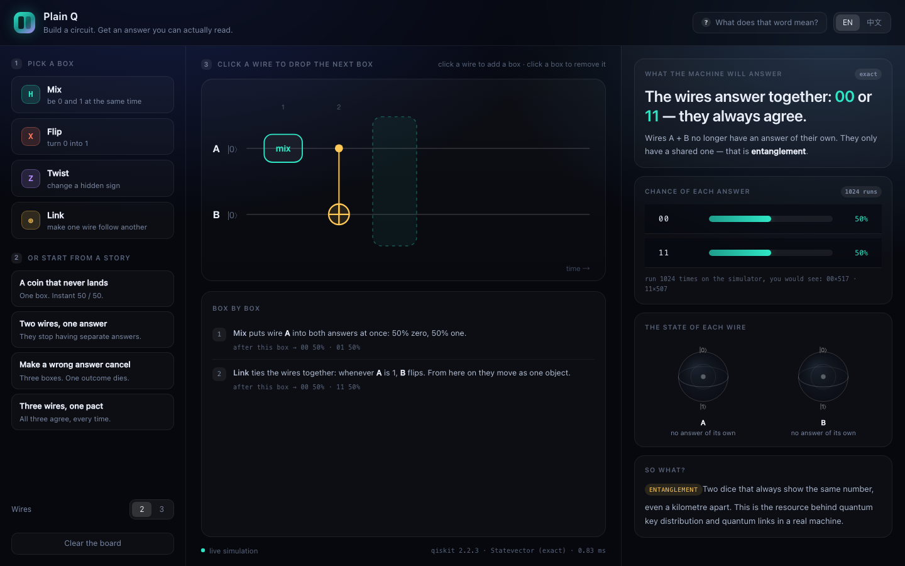

# Plain Q

**A quantum circuit you can actually read.**

> Qiskit Fall Fest 2026 — UW Quantum Club. Brief: build a quantum tool for people
> who know nothing about quantum computing.

You drag boxes onto wires. A real Qiskit simulation runs behind them. And then the
page tells you, in one sentence, what you just did — not in amplitudes and basis
states, but in English (or 中文).



---

## Run it

```sh
cd plain-q
./run.sh
```

That creates a virtualenv, installs Qiskit the first time, and opens
<http://127.0.0.1:8765>. Needs Python 3.9+ and nothing else — no Node, no CDN, no
internet at demo time.

Different port: `./run.sh 9000`.

### The tutor (Nebius Token Factory + NVIDIA Nemotron)

Plain Q works with no internet. One feature is the exception: **Ask about this
board**, the box at the bottom of the page, where you can ask a follow-up
question in your own words.

```sh
cp .env.example .env      # then paste your key
# NEBIUS_API_KEY=...
./run.sh
```

With a key, your question and *the numbers Qiskit already computed* go to an
**NVIDIA Nemotron** model served by **Nebius Token Factory** (OpenAI-compatible
`/chat/completions`), and one 60–110 word answer comes back in English or
Chinese. Without a key nothing breaks: the tutor shows as `offline` and the rest
of the app is unchanged.

Two deliberate choices:

- **The model is never asked to do the physics.** It receives the exact
  probabilities, Bloch vectors and entropies from `server.py` and is instructed
  not to invent a number. If the numbers and the prose ever disagree, the numbers
  are the ones on screen.
- **The state is re-simulated server-side** for every question, not taken from
  the browser, so the tutor can only ever see values this process computed.

The narration you see without asking anything — the headline, the sentence under
every box — is not generated by a model. It is the rule engine in `static/app.js`
(`describe()`, `stepText()`), which reads the distribution and picks a sentence.
That is why the page works offline and why every claim on it is reproducible.

## The four boxes

| Box | What it really is | What we tell the user |
|---|---|---|
| **Mix** | Hadamard | be 0 and 1 at the same time |
| **Flip** | Pauli-X | turn 0 into 1 |
| **Twist** | Pauli-Z | change a hidden sign |
| **Link** | CNOT | make one wire follow another |

No `H`, no `X`, no `|ψ⟩` on the surface. The notation is available in the
**"? What does that word mean?"** panel, for the people who want it.

## What the app does that a circuit composer does not

1. **It reads the state back to you.** For every gate you add, the backend returns
   the full statevector; the page turns that into one sentence per step
   ("Two paths cancelled: `00` just became impossible").
2. **It names the phenomenon from the numbers, not from a template.** The headline
   is chosen by checking the actual distribution and the per-qubit Bloch vectors —
   so `Mix → Link` says *"the wires answer together"* while `Mix → Twist → Mix` says
   *"one answer, every time"*. Same UI, opposite lessons.
3. **It shows what a qubit looks like when it has no answer of its own.** In the
   Bell and GHZ stories both Bloch arrows collapse to the centre of the sphere.
   That is the visual most explainers skip.
4. **It never asks the user to trust it.** The exact probability is shown next to
   1024 sampled shots, plus the Qiskit version and the simulation time in the
   footer.

## Stories (the 30-second tour)

Click any of these in the left rail, or deep-link them:

| Story | Circuit | Deep link |
|---|---|---|
| A coin that never lands | Mix on A | `?story=coin` |
| Two wires, one answer | Mix A → Link A→B | `?story=bell` |
| Make a wrong answer cancel | Mix A → Twist A → Mix A | `?story=cancel` |
| Three wires, one pact | Mix A → Link A→B → Link B→C | `?story=ghz` |

Add `&lang=zh` to any of them for the Chinese UI.

## How it is built

```
server.py          stdlib http.server  +  Qiskit
  POST /api/simulate   { n, gates[] } → { probs, per-qubit Bloch, per-step state, shot counts }
  POST /api/ask        { n, gates[], question, lang } → one paragraph from Nemotron
  GET  /api/tutor      → { enabled, model, provider }  (so the UI can show "offline")
narrator.py        the only outbound call: Nebius Token Factory, stdlib urllib, no SDK
static/
  index.html       shell
  style.css        dark console theme, no framework
  app.js           circuit renderer (SVG), Bloch spheres (canvas), narration engine, tutor box
```

- Quantum: `qiskit.quantum_info.Statevector` — **exact**, no sampling noise, so the
  probabilities are the true ones and the narration can talk about 50.0% instead of
  ~49.3%.
- Entanglement is detected honestly: the global state is pure, so a mixed reduced
  state (entropy > 0) *means* entanglement. No hardcoded "if circuit == Bell then
  say entangled".
- Sampling: `Statevector.sample_counts(1024)` with a fixed seed, so the shot counts
  are reproducible on stage.
- Frontend is vanilla JS, no build step. It works offline, which matters when the
  venue wifi is what it is.

## Limits (stated, not hidden)

- 2–3 wires, 6 boxes, gates limited to H / X / Z / CNOT. That is a deliberate
  scope: every combination fits on one screen and stays explainable in one sentence.
- Runs on the statevector simulator, not on IBM hardware. `qiskit-ibm-runtime` would
  be a drop-in addition — same circuit object, `Sampler` instead of `Statevector`.
- Measurement is explained, not animated (the app shows what *would* happen).

## Files worth showing a judge

- `static/app.js` → `describe()` and `stepText()`: the narration engine.
- `static/app.js` → `isInterference()`: the rule that separates real interference
  from a CNOT merely rewriting an outcome.
- `server.py` → `_analyse()`: statevector → per-qubit Bloch vector + entropy.
